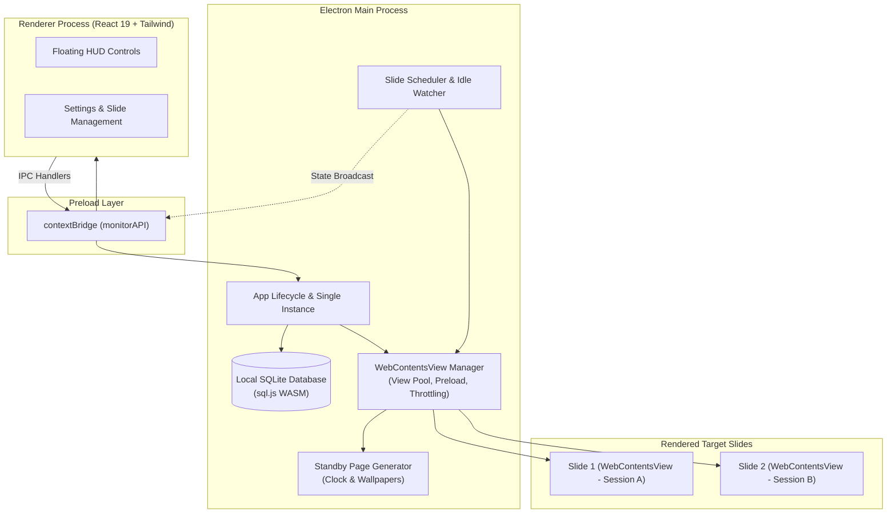

# OrbitSlide

<p align="center">
  
</p>

<p align="center">
  <strong>Automated multi-website slideshow and digital display runner for Windows.</strong>
</p>

<p align="center">
  <a href="https://github.com/pratama1246/OrbitSlide/releases/latest"></a>
  <a href="https://github.com/pratama1246/OrbitSlide/releases/latest"></a>
  <a href="https://www.electronjs.org/"></a>
  <a href="https://react.dev/"></a>
  <a href="https://sqlite.org/"></a>
  <a href="LICENSE"></a>
</p>

<p align="center">
  <a href="https://github.com/pratama1246/OrbitSlide/releases/latest"><strong>⬇ Download Installer (OrbitSlide-Setup-1.0.0.exe)</strong></a>
</p>

---

OrbitSlide is an open-source desktop application that displays multiple web pages on a rotating schedule for wallboards, control rooms, kiosk PCs, and ambient secondary monitors. Each website runs in an isolated Chromium view (`WebContentsView`) with persistent cookies and configurable reload intervals.

All configurations and slide data are stored locally in SQLite (`orbitslide.db`). OrbitSlide operates standalone without cloud dependencies, external telemetry, or tracking pings.

---

## Use Cases

- **NOC & IT Operations**: Rotate Grafana dashboards, Zabbix, Portainer, and Kubernetes status portals with persistent login cookies and self-signed SSL bypass.
- **Offices & Workspaces**: Cycle agile boards (Trello, Jira, Linear), sales dashboards, KPI trackers, and internal announcement pages on wall-mounted screens.
- **Retail & Digital Signage**: Run web-based menu boards, price lists, promo slides, or customer queue displays on unattended kiosk PCs.
- **Smart Home & Homelabs**: Turn an idle secondary monitor or mini PC into a continuous display for Home Assistant, live weather, or network statistics.

---

## Key Features

- **Automated Rotation & Preloading**
  - Slides rotate based on individual or default duration timers.
  - Next slide preloads in the background to avoid blank white screens during transitions.
  - Off-screen slide views throttle rendering to conserve CPU and RAM while keeping active background WebSocket connections alive.
- **Isolated Sessions & Persistent Cookies**
  - Uses separate Chromium session partitions (`persist:default`, `persist:admin`, or custom profiles).
  - Login sessions and cookies remain saved across application restarts.
  - Optional ignore-certificate-errors toggle for internal intranet hosts using self-signed SSL certificates.
- **Operator Interaction & Idle Detection**
  - Moving the mouse over an active slide automatically pauses the rotation timer so operators can interact with the page.
  - Rotation resumes automatically after a configurable period of inactivity (default: 30 seconds).
- **Offline Standby Screen & Wallpapers**
  - When no slides are active, OrbitSlide displays a standby screen with a digital clock, local date, and live status beacon.
  - Supports custom wallpaper uploads (up to 3 local images) with alternating crossfade transitions.
- **Bilingual Interface**
  - Full interface support for Indonesian and English, with automatic locale detection.
- **Kiosk Mode & Auto-Start**
  - Supports borderless fullscreen mode (`F11`).
  - Includes a PowerShell setup script to configure Windows Task Scheduler for auto-start on user logon.

---

## System Architecture



---

## Repository Structure

```text
OrbitSlide/
├── public/                     # Static assets, favicon, and SVG logos
├── resources/icons/            # Windows installer & runtime icons (.ico, .png)
├── scripts/
│   ├── setup-windows-kiosk.ps1 # PowerShell script for Windows Task Scheduler auto-start
│   └── README-KIOSK.md         # Kiosk deployment documentation
├── src/
│   ├── main/
│   │   ├── database.ts         # SQLite WASM storage layer (slides & app settings)
│   │   ├── index.ts            # Application entry, IPC handlers, single-instance lock
│   │   ├── scheduler.ts        # Rotation timer, pause/resume, and operator idle detection
│   │   ├── standbyPage.ts      # Standby screen HTML/CSS/JS generator
│   │   ├── viewHost.ts         # Base view host contract
│   │   └── viewManager.ts      # WebContentsView lifecycle, preloading, and throttling
│   ├── preload/
│   │   └── index.ts            # Secure contextBridge API definition
│   ├── renderer/
│   │   ├── components/         # Floating HUD, Settings modal, Standby, Error fallback
│   │   ├── i18n.ts             # Indonesian and English localization dictionaries
│   │   ├── App.tsx             # Main application state orchestrator
│   │   └── main.tsx            # React 19 entrypoint
│   └── types/                  # Shared TypeScript interfaces
├── package.json
└── vite.config.ts
```

---

## Keyboard Shortcuts

| Shortcut | Description |
| :--- | :--- |
| `Space` | Pause or resume slideshow rotation |
| `F11` | Toggle fullscreen mode |
| `Esc` | Exit fullscreen mode |
| `Ctrl + Left Arrow` | Navigate to previous slide |
| `Ctrl + Right Arrow` | Navigate to next slide |
| `Ctrl + ,` | Open or close Settings dialog |

---

## Development Guide

### Prerequisites
- Node.js 20+ (LTS recommended)
- npm or yarn

### Installation
```bash
git clone https://github.com/pratama1246/OrbitSlide.git
cd OrbitSlide
npm install
```

### Running Locally
```bash
npm run dev
```

### Building Production Installer
```bash
# Compile and package Windows x64 NSIS installer (.exe)
npm run package

# Build unpacked folder for local testing
npm run package:dir
```
Installer output is written to the `release/` directory (e.g. `OrbitSlide-Setup-1.0.0.exe`).

---

## Windows Kiosk Setup (Auto-Start)

For 24/7 unattended display PCs:
1. Open PowerShell as Administrator.
2. Run the deployment script:
   ```powershell
   powershell -ExecutionPolicy Bypass -File scripts\setup-windows-kiosk.ps1
   ```
3. The script registers a Windows Task Scheduler job to launch OrbitSlide automatically when the target user logs in.

For uninstall instructions or custom task configurations, see [scripts/README-KIOSK.md](scripts/README-KIOSK.md).

---

## License

This project is licensed under the [MIT License](LICENSE).
