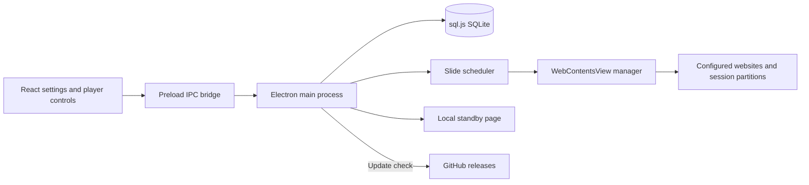

# OrbitSlide

<p align="center"></p>

Windows desktop display player that rotates configured web pages using Electron `WebContentsView` instances and persistent session profiles. Useful for dashboard wallboards, kiosk displays, and other screens that need several sites in a timed rotation.

**Start:** choose a build from [Releases](https://github.com/pratama1246/OrbitSlide/releases) or [Build from source](#build-from-source), then [Configure a slideshow](#configure-a-slideshow). **Project contact:** [Pratama Putra](https://github.com/pratama1246); report reproducible problems in [repository issues](https://github.com/pratama1246/OrbitSlide/issues). No operational on-call rota or 24/7 availability guarantee is documented.

Slide configuration is local SQLite data, while loaded websites still use their own network services and cookies. The update-check action contacts GitHub. Local storage does not mean websites work offline or establish a zero-telemetry guarantee. See [Privacy](PRIVACY.md), [Terms](TERMS.md), and [License](LICENSE).

## Reader assumptions

Operators should understand URLs, site authentication, Windows sign-in, and network connectivity. Developers also need Node.js, npm, React/TypeScript, and Electron. Source commands below run in PowerShell at the repository root. Application keyboard behavior depends on whether focus is in the OrbitSlide interface or in a loaded website.

## Choose a section

- [Operator procedures](#operator-procedures)
- [Troubleshooting and escalation](#troubleshooting-and-escalation)
- [Developer procedures](#developer-procedures)
- [Configuration and storage reference](#configuration-and-storage-reference)
- [Shortcut reference](#shortcut-reference)
- [Dependency reference](#dependency-reference)
- [Architecture explanation](#architecture-explanation)
- [Source reference](#source-reference)

## Operator procedures

### Configure a slideshow

1. Open OrbitSlide and open **Settings** using the interface controls; if focus is inside a website, use Alt+S.
2. Add a slide with its name, intended URL, duration, and session profile.
3. Enable the slide and save it.
4. Start monitoring/rotation using the interface control.
5. If the site requires login, authenticate in its selected session profile.
6. Wait for a transition and verify that the next enabled slide loads.

Expected result: enabled sites rotate for their configured durations and use their assigned session profiles. Persistent cookies do not override a site's own session expiry, SSO, or MFA policies. With no active slides, the local standby screen appears; that is not an offline copy of your dashboards.

### Interact with a displayed website

1. Move the pointer onto the active website and interact with the required control.
2. Observe whether rotation is paused by interaction or manually paused.
3. Stop interacting and allow the configured idle timeout to elapse, or resume using the player control.

Expected result: interaction-based pause resumes after the configured idle period (default 30 seconds). A manually paused rotation needs an explicit resume. Use the [Shortcut reference](#shortcut-reference) to avoid sending player commands while entering text in a website.

### Configure launch at Windows sign-in

1. In OrbitSlide Settings, review launch-on-startup, start-fullscreen, and auto-start-monitoring options.
2. Save only the options intended for this display account.
3. Sign out/in during an agreed test window.
4. Confirm the application opens, the correct sites load, and any authentication requirements are satisfied.

Expected result: the configured display works after that user signs in. This does not start a visible desktop before sign-in or configure Windows auto-logon. If Task Scheduler is required instead, follow [the kiosk guide](scripts/README-KIOSK.md); choose one startup mechanism to avoid duplicate launches. The script needs `-InstallTask`; running it with no action switch only displays guidance.

### Back up display configuration

1. In the application information/settings interface, note the reported user-data path. Stop monitoring first if the interface prevents opening that directory while it is active.
2. Close OrbitSlide and confirm its process has exited.
3. Copy the complete user-data directory to the host owner's protected backup location.
4. Record the app version, chosen startup mechanism, and site/session profile names.

Expected result: the backup includes `orbitslide.db` and the intended persistent session data. Session profiles can contain authenticated cookies; protect the backup as account data. Do not delete/reset that directory as a first troubleshooting step.

## Troubleshooting and escalation

| Symptom | Operator checks | Stop and escalate when |
|---|---|---|
| Blank/error slide | Inspect its URL and displayed load error; test the site in the intended network; reload once. | The site is unavailable or its authentication/network policy needs changing: contact the site/network owner. |
| Standby instead of slideshow | Check that at least one slide is active and monitoring is started. | Active records disappear or database errors persist: contact the maintainer. |
| Login repeatedly expires | Check the assigned session profile and site session policy. | SSO/MFA or cookie handling needs a code/policy change; do not share credentials in issues. |
| Unexpected pause | Distinguish manual pause, pointer interaction, idle timeout, and open popups/settings. | Rotation does not resume after the intended state ends. |
| Certificate failure | Check hostname, time, certificate trust, and the site's approved certificate policy. | Fix needs a trust exception: ask the site/network owner before changing certificate handling. |
| No launch after reboot | Check whether the user signed in, the executable still exists, and the chosen startup entry/task points to it. | Windows account/task policy changes are needed. |
| Increased resource use / crashed view | Record number of slides, keep-alive/reload settings, failed URL, and app/runtime version. | A view repeatedly crashes or ordinary reload fails; preserve the evidence before resetting data. |

Escalation route: website/authentication/network failures go to the relevant site or host administrator; reproducible OrbitSlide state/view errors go to the project contact. Include app revision, Windows build, time, session profile name, sanitized URL/error, expected/actual result, and checks performed. Remove cookies, tokens, private query parameters, and dashboard contents from public reports.

## Developer procedures

### Build from source

Use Windows x64 for the configured NSIS installer target. The locked Electron package requires Node.js >=22.12.0; this is stricter than saying only "Node 20+". Source package version is 1.0.0; it does not prove a particular release asset is published.

1. In a terminal, clone `https://github.com/pratama1246/OrbitSlide.git` with Git.
2. Enter that checkout directory (named `MonitorSlide` in the reviewed local workspace).
3. At its root, run `npm ci` to install locked dependencies.
4. Run `npm run build` to type-check and build the renderer/main/preload output.
5. For an unpacked application directory, run `npm run package:dir`.
6. For the Windows installer, run `npm run package`.

Expected result: build reports success; packaged output is under `release`. The configured installer pattern is `OrbitSlide-Setup-${version}.exe`. Packaging does not prove signing or successful deployment on another host. For interactive development use `npm run dev`; it launches the application and may load configured sites, so use a test Windows profile.

### Verify a change

1. Run `npm run build` at the repository root.
2. In a test profile, launch the application and verify adding/editing a slide, rotation, pause/resume, settings, and relaunch persistence.
3. Verify keyboard actions with focus both in the OrbitSlide UI and inside a target site.
4. Test the affected site/load-error behavior before distributing a package.

Expected result: build passes and the relevant player behavior works. No test script is declared in `package.json`; a build does not replace interaction checks. This documentation revision did not launch website sessions or execute packaging.

## Configuration and storage reference

| Item | Meaning |
|---|---|
| Slide `duration`, `is_active`, `sort_order` | Rotation duration, participation, and ordering. |
| `session_profile` | Persistent Electron partition chosen for that site's cookies/session. |
| `keep_alive`, `reload_interval` | Background view and reload behavior; inspect per-site effects on authentication and resources. |
| `default_duration`, `idle_timeout_seconds` | Defaults: 15-second slide duration, 30-second interaction idle timeout. |
| `auto_start_monitoring`, `start_fullscreen`, `launch_on_startup` | Defaults: true, false, false; start-at-login does not mean boot-before-login. |
| `theme`, `language` | Theme and Indonesian/English interface selection. |
| `ignore_certificate_errors` | Default true in source; main-process bypass is restricted to private/local hosts. It is not a general trust guarantee. Review the setting with the network owner. |
| User data | `app.getPath('userData')`; SQLite file is `orbitslide.db`. Obtain the actual path through app information rather than assuming a fixed folder. |

## Shortcut reference

This table follows `src/main/viewManager.ts`; focus in a loaded website changes some actions.

| Context | Shortcut | Action |
|---|---|---|
| UI or website view | F11 / Escape | Toggle fullscreen / perform escape handling. |
| UI or website view | F5 or Ctrl+R | Reload active slide. |
| UI or website view | Ctrl+0 | Reset zoom for the focused view. |
| OrbitSlide UI | Space | Toggle play/pause. |
| OrbitSlide UI | Left / Right Arrow | Previous / next slide. |
| OrbitSlide UI | S | Settings. |
| Inside a website | Alt+Left / Alt+Right | Previous / next slide. |
| Inside a website | Alt+S | Settings. |

## Dependency reference

Versions below are read from the current `package-lock.json`. They are resolved package versions, not evidence of a completed runtime test.

| Package | Locked version |
|---|---|
| `@fontsource-variable/plus-jakarta-sans` | 5.3.0 |
| `react` | 19.3.1 |
| `react-dom` | 19.3.1 |
| `sql.js` | 1.15.1 |
| `@tailwindcss/vite` | 4.3.3 |
| `@types/node` | 26.6.5 |
| `@types/react` | 19.3.0 |
| `@types/react-dom` | 19.3.0 |
| `@types/sql.js` | 1.4.11 |
| `@vitejs/plugin-react` | 6.1.2 |
| `electron` | 45.0.0 |
| `electron-builder` | 26.15.3 |
| `tailwindcss` | 4.3.3 |
| `typescript` | 7.0.2 |
| `vite` | 8.3.5 |
| `vite-plugin-electron` | 1.1.2 |

## Architecture explanation

The Electron main process manages SQLite, timers, session partitions, and website views. The preload bridge exposes application actions to the React interface. Website content runs in separate `WebContentsView` instances. Standby is generated locally; loaded pages and the explicit update check use external connections. View preloading/throttling mechanisms do not establish fixed CPU/RAM or uninterrupted-WebSocket guarantees.



## Source reference

```text
src/main/          Lifecycle, database, scheduler, view manager and standby
src/preload/       Renderer IPC bridge
src/renderer/      React interface and translations
src/types/         Shared slide/settings/runtime types
scripts/           Windows Task Scheduler setup and kiosk guide
resources/         Installer/application icons
package.json       Scripts and electron-builder configuration
package-lock.json  Resolved dependency versions
```

See [LICENSE](LICENSE) for the MIT license. Windows kiosk setup and external-site behavior must be validated on the intended host; this README does not guarantee unattended availability.
